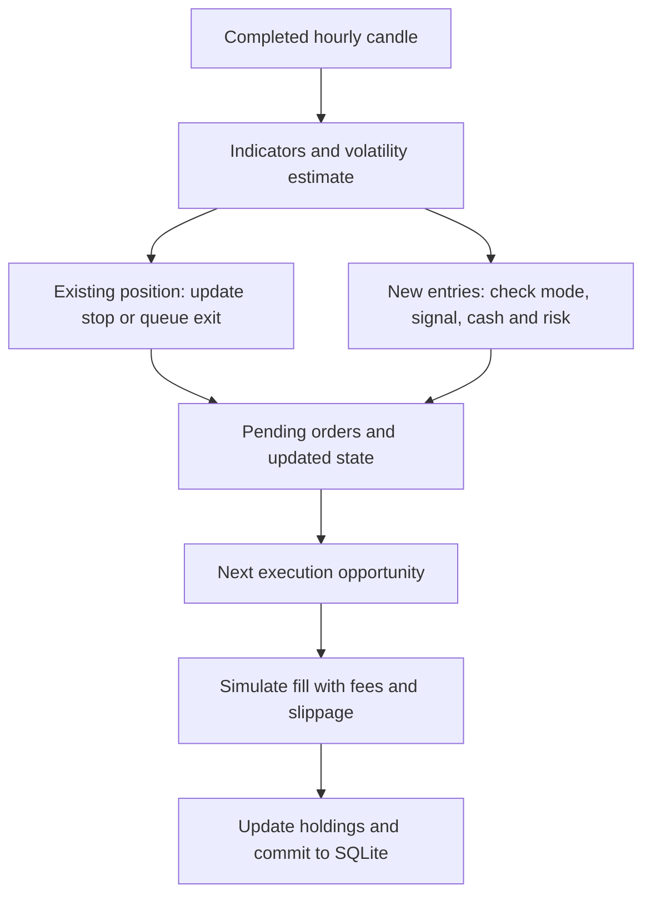

# How the Bitcoin Trading Agent Works

This guide explains the trading behaviour implemented in the maintained `market/`, `trading/`, and `paper_loop.py` code. Setup and command-line instructions are in [README.md](README.md).

The bot manages a **simulated, long-only BTC account** through two strategies: accumulating BTC after price declines and opening a single swing position on a moving-average crossover. GARCH forecasts adjust the size of swing purchases and can tighten their stops. A separate Gemini observer can suggest a strategy mode, but those suggestions never change the trading engine automatically.

Examples below use the checked-in `config.json`. Prices and forecasts in worked examples are illustrative, not recorded trading results.

## 1. The account has three separate cash pools

The default $10,000 account starts with:

| Pool | Initial amount | Behaviour |
| --- | ---: | --- |
| DCA | $6,000 | Funds repeated accumulation purchases; acquired BTC stays in the DCA holdings. |
| Swing | $3,000 | Funds one active swing position at a time; sale proceeds return to this pool. |
| Reserve | $1,000 | Remains cash; the current strategies do not automatically deploy it. |

A strategy cannot borrow from another pool. The bot can hold accumulated DCA BTC and an active swing position simultaneously. It does not short BTC, borrow money, or use leverage.

A $3,000 swing allocation does **not** mean each swing purchase spends $3,000. The default base purchase is $1,000, potentially reduced by volatility and available swing cash. There is no pyramiding into an already active swing position.

## 2. Signals, risk checks, fills, and accounting are separate

A signal expresses an intention to trade. It is not itself a completed trade.

The hourly decision function, `process_close`, does not execute orders. Historical execution occurs in `process_candle`; live paper execution occurs in `process_quote`. Accounting accepts the resulting fills and updates the correct cash and BTC balances.

This separation prevents a backtest from buying at an earlier price using a signal that only became available later.

## 3. DCA: accumulate after a drop from the last purchase

Despite its name, this implementation is **dip-triggered accumulation**, rather than a purchase every day or week.

At an eligible completed candle close, a DCA buy is queued when:

1. The current strategy mode permits DCA entries.
2. No DCA buy is already pending.
3. Either no DCA purchase has occurred yet, or the close is sufficiently below the last DCA fill price.
4. The DCA cash pool can pay the full configured purchase amount.

The price condition is:

$$
\frac{P_{\mathrm{last\ DCA\ fill}}-C_t}{P_{\mathrm{last\ DCA\ fill}}}\geq d,
$$

where $C_t$ is the completed hourly close and the default drop threshold is $d=0.03$.

With a last DCA fill at $100,000, a close at or below $97,000 qualifies. A $500 order is then queued. If that order actually fills at $97,100, the next threshold is based on **$97,100**, giving $94,187—not on the earlier signal close.

The order budget includes the purchase fee. A large one-hour decline queues one configured purchase, not several purchases for each threshold crossed. If less than $500 remains in DCA cash, the default strategy skips the purchase rather than spending a smaller remainder.

**There is no implemented DCA sell rule.** ATR stops, GARCH trailing stops, and bearish-crossover exits apply to the swing position. DCA holdings can therefore remain exposed throughout a prolonged decline.

DCA does not require a successful GARCH estimate or valid SMA/ATR indicators inside `process_close`. In the live runner, however, the entire close decision still passes through the forecast workflow: if the forecast finishes after the five-minute deadline, that close is skipped, including its potential DCA decision. A failed forecast returned within the deadline can still allow DCA processing.

## 4. Swing entries: trade a crossover event

The bot calculates two simple moving averages of hourly closes:

$$
\operatorname{SMA}_{n,t}=\frac{1}{n}\sum_{j=0}^{n-1} C_{t-j},
\qquad n\in\{20,50\}.
$$

The signal requires a **crossing between consecutive candles**, not merely one average being above the other.

| Entry setting | Previous candle | Current candle | Interpretation |
| --- | --- | --- | --- |
| `bull` | SMA 20 ≤ SMA 50 | SMA 20 > SMA 50 | Buy after the shorter average crosses upward. |
| `bear` | SMA 20 ≥ SMA 50 | SMA 20 < SMA 50 | Buy after the shorter average crosses downward. |

The checked-in setting is **`bear`**. This deliberately opens a long position on a downward crossover; it is not a short-selling strategy. Whether that contrarian entry is useful is an empirical question, not something established by the code.

A new swing order also requires:

- A mode that permits swing entries.
- No active swing position.
- No exit in the relevant candle/exit guard period.
- Finite current and previous SMA values and a finite, positive ATR.
- A valid current volatility forecast.
- An approved purchase amount at least as large as the configured minimum.

If a crossover occurs while the forecast is unavailable, the signal is skipped. Remaining below or above the moving average does not create a new crossover on the next hour, so the bot does not automatically retry that missed entry.

## 5. GARCH estimates next-hour volatility

GARCH answers: **how variable might the next hourly return be, given recent return behaviour?** It does not forecast whether BTC will rise or fall.

### Model and fitting

`market/volatility.py` fits a zero-mean GARCH(1,1) model with Student-t innovations using the `arch` package. In decimal-return notation, its structure is:

$$
r_t=\log(P_t/P_{t-1})=\sqrt{h_t}\,z_t,
$$

$$
h_t=\omega+\alpha r_{t-1}^{2}+\beta h_{t-1},
$$

where $z_t$ has a standardized Student-t distribution and $h_t$ is conditional variance. The three variance terms represent a baseline, the contribution of the previous squared shock, and persistence from previous conditional variance.

The implementation fits **percentage log returns**, $100r_t$, with `mean="Zero"`, `vol="GARCH"`, `p=1`, `q=1`, `dist="t"`, and `rescale=False`. It divides the forecast variance by $100^2=10,000$ before returning decimal units.

Thus `sigma_next_hour = 0.008` means a forecast standard deviation of approximately **0.8% for one hour**. It is not an annualized figure, an expected gain, or a promise that returns will remain inside ±0.8%.

### Window, warm-up, and failures

The default forecast window is 4,320 hourly observations, approximately 180 days. Each forecast uses only history available through the completed candle being evaluated. The current engine requires `forecast_every_hours = 1`.

At least 500 adjacent pairs of observed closes are required to pass the volatility warm-up gate. A pair spanning a missing close does not count as an observed hourly return.

Every fitted path must converge and produce a finite, positive forecast variance. Otherwise the estimate is marked `fit_failed`; insufficient observed returns produce `warming_up`. New swing entries require `status == "ok"`. An existing stop remains active even when no fresh forecast is available.

### Missing closes: conditional paths for modelling

The preparation code preserves the hourly grid, removes unfinished candles, and marks unusable OHLC candles as missing. It does not invent candle highs and lows for trading.

When the forecasting window has missing closes, `market/missing_data.py` uses a separate latent log-price model:

$$
x_t=x_{t-1}+\eta_t,\qquad \eta_t\sim N(0,q).
$$

This is a driftless Gaussian random walk without measurement noise. For consecutive observed log-price endpoints separated by $d_i$ hours, the implementation estimates:

$$
\widehat q=\frac{1}{m}\sum_{i=1}^{m}\frac{(x_{i,\mathrm{end}}-x_{i,\mathrm{start}})^2}{d_i}.
$$

A `statsmodels` simulation smoother generates conditional historical paths consistent with the observed data in that window. Observed log prices are explicitly retained. The default is five paths, each converted into percentage log returns and fitted with its own GARCH model.

If the decimal variance forecasts are $v_1,\ldots,v_M$, the final estimate is:

$$
\widehat\sigma_{t+1}=\sqrt{\frac{1}{M}\sum_{j=1}^{M}v_j}.
$$

This averages **variances before taking the square root**, rather than averaging standard deviations. The smallest and largest path standard deviations are also recorded; they are path diagnostics, not a calibrated confidence interval.

When no closes are missing, the code uses one observed-return path and fits once. The five-path setting does not mean five future price forecasts or five trading strategies.

The imputation model is a separate approximation, not joint estimation of missing returns under the GARCH likelihood. Conditioning on later observed endpoints within the available history helps model earlier gaps; it does not establish what could actually have traded during those gaps. Forecasting paths never become execution prices.

## 6. GARCH controls swing purchase size

Let $B$ be the base swing amount, $K$ the available swing cash, $\sigma$ the current hourly forecast, and $\sigma_{\mathrm{ref}}$ the reference volatility. When sizing is enabled:

$$
A=\min\left(K,\ B\min\left(1,\frac{\sigma_{\mathrm{ref}}}{\sigma}\right)\right).
$$

The result is rounded **down** to cents. If it is below the minimum purchase, no order is created.

With $B=\$1,000$, $\sigma_{\mathrm{ref}}=0.004$, and sufficient cash:

| Forecast hourly sigma | Sizing multiplier | Approved budget, including fee |
| --- | ---: | ---: |
| 0.2% | 1.00 | $1,000 |
| 0.4% | 1.00 | $1,000 |
| 0.8% | 0.50 | $500 |
| 1.6% | 0.25 | $250 |

Low volatility never increases the purchase beyond the base amount. Available cash imposes another cap. The default minimum is $25; an amount below that threshold is skipped, not rounded up.

Setting `garch_sizing_enabled` to `false` uses a multiplier of one, **but still requires a valid current forecast**. The code retains that gate so enabled/disabled sizing comparisons have the same forecast-availability condition.

This is inverse-volatility scaling with caps. It does not size positions to a fixed dollar loss at the ATR stop, and it does not directly target total portfolio volatility or control DCA exposure.

## 7. Swing exits

Every implemented swing exit sells the **entire active swing position**. There are no partial profit-taking orders.

### Initial ATR stop

True range is:

$$
\operatorname{TR}_t=\max\left(H_t-L_t,\ |H_t-C_{t-1}|,\ |L_t-C_{t-1}|\right).
$$

The project uses a simple 14-period rolling mean of true range—not Wilder's recursive smoothing. ATR is computed separately within uninterrupted observed OHLC segments, so missing candles restart its warm-up.

On a swing fill, the initial stop is:

$$
S_0=P_{\mathrm{fill}}-k_{\mathrm{ATR}}\operatorname{ATR}_{\mathrm{signal}}.
$$

The default multiplier is $k_{\mathrm{ATR}}=2$. A $100,000 fill with a signal-candle ATR of $800 gives a $98,400 stop. The ATR is captured when the order is created; the entry price is the eventual simulated fill price.

This stop does not protect the separate DCA holdings, and it does not guarantee a sale at exactly $98,400 if the observed market gaps below it.

### GARCH trailing stop

With an active position and a valid forecast, an eligible completed close proposes:

$$
S_{\mathrm{candidate}}=C_t\exp(-k_{\mathrm{GARCH}}\widehat\sigma_{t+1}),
$$

$$
S_{\mathrm{new}}=\max(S_{\mathrm{old}},S_{\mathrm{candidate}}).
$$

The default multiplier is three. At a $103,000 close and sigma of 0.5%, the candidate is approximately $101,466.53. An old $98,400 stop rises to that value; an old $102,000 stop stays at $102,000.

The stop can only rise. Increased volatility cannot loosen an already higher stop. Falling volatility can tighten it even without a price increase. There is no separate profit threshold that must be reached before trailing starts, and the calculation uses the latest close rather than an explicit highest-price-since-entry variable.

In a backtest, a close-based update applies to subsequent execution, not retrospectively to the candle that produced it. Live paper trading applies it after the forecast and close decision finish, then checks it against later quotes.

A multiplier of three is a strategy parameter, not a guaranteed “three-sigma” loss bound or a calibrated 99.7% coverage statement—particularly with Student-t returns and execution gaps.

### Bearish-crossover exit

When enabled, an existing swing position queues an exit if SMA 20 crosses from at-or-above SMA 50 to below it. The order fills at the next execution opportunity; it does not sell retrospectively at the signal close.

This exit needs the relevant SMA values, but does not require a valid GARCH estimate. The existing stop also continues to operate independently of a successful new forecast.

Because the default entry is also `bear`, the same kind of crossover can mean **buy when flat** or **exit when already invested**. A newly queued entry does not create an active position during that close decision, so it is not immediately sold by the same signal. A later downward crossover may trigger the exit.

### What is not implemented

There is no fixed take-profit target, maximum holding period, DCA liquidation rule, automatic reserve deployment, or automatic portfolio rebalancing. Existing holdings are not forcibly liquidated at the end of a backtest; remaining BTC is valued at the last observed close.

## 8. Backtest execution versus live paper execution

Both paths use the shared close-decision rules, but execution observations differ.

| Behaviour | Historical backtest | Live paper runner |
| --- | --- | --- |
| Data | Hourly Yahoo Finance BTC-USD candles | Coinbase public candles and bid/ask quotes |
| Pending buys | Next observed candle open, subject to gap handling | Next processed eligible quote at the ask |
| Pending swing sells | Next observed candle open | Next processed quote at the bid |
| Stop check | Candle open, then intrabar low | Current observed bid |
| Gap through a stop | Open below stop fills at the open, then slippage | Fills at observed bid, then slippage |
| Valuation | Observed candle close, or marked-stale prior close during gaps | Bid/ask midpoint |

The backtest processes pending swing sells before pending buys, then checks the active stop, then evaluates the close. Consequently a newly filled swing position can stop out during its entry candle. A completed swing exit blocks another swing entry during that candle; DCA remains a separate decision.

In live operation, quote monitoring normally runs every 10 seconds, with a 30-second quote-age limit. Historical candles refresh on a separate schedule, normally every 60 seconds, and GARCH fitting runs in a separate process so fitting does not block quote checks.

A new live account loads historical warm-up data and waits for the next completed candle. It does not replay old historical trades. A close decision more than 300 seconds late is skipped. Pending entry orders expire one hour after their signal time, and additional outage checks can cancel them sooner.

A quote-monitoring gap exceeding 60 seconds cancels pending buys. If a swing position was open, the account is marked execution-uncertain because the bot cannot know whether a stop was crossed while offline. Missing hourly decisions have similar protective handling. The live runner also carries an exit-hour guard to avoid reopening a swing position around the same close after a quote-based exit.

These rules mean a live paper run should not be expected to reproduce a historical backtest exactly: providers, execution prices, spread, polling, forecast latency, and outages differ.

## 9. Fees, slippage, and profit accounting

For a buy budget $A$, fee rate $f$, and adverse slippage rate $s$:

$$
P_{\mathrm{fill}}=P_{\mathrm{reference}}(1+s),\qquad
\text{purchase value}=\frac{A}{1+f},\qquad
Q_{\mathrm{BTC}}=\frac{A}{(1+f)P_{\mathrm{fill}}}.
$$

The fee is included in $A$, not added on top. With a $500 budget, 0.1% fee, zero slippage, and a $100,000 reference price, approximately $499.50 buys BTC and $0.50 pays the fee, giving approximately 0.004995 BTC.

A sale uses $P_{\mathrm{reference}}(1-s)$ and credits gross sale proceeds minus its fee. Live buys reference the ask and live sells reference the bid, so the bid/ask spread affects execution even when configured slippage is zero.

Realized swing profit is net sale proceeds minus the full fee-inclusive purchase cost. Unrealized profit is the current marked value of held BTC minus its purchase cost. Total account value is:

$$
V=\text{DCA cash}+\text{swing cash}+\text{reserve cash}
  +(\text{DCA BTC}+\text{swing BTC})P_{\mathrm{mark}}.
$$

Marks do not deduct a hypothetical future liquidation fee. The model assumes no deposits or withdrawals. A profitable swing strategy can coexist with a falling total portfolio if accumulated DCA holdings lose enough value.

## 10. Modes, configuration, and the advisor

| Mode | DCA buys | Swing buys | Existing swing exits |
| --- | --- | --- | --- |
| `hybrid` | Allowed | Allowed | Continue |
| `dca_only` | Allowed | Blocked | Continue |
| `pause_entries` | Blocked | Blocked | Continue |

Changing mode cancels disallowed pending buys. It does not sell existing positions or erase their stops. In particular, `pause_entries` means stop opening new exposure, not convert the account to cash.

Google Sheets can supply validated configuration changes from a restricted live-edit allowlist. Capital-allocation settings are not freely changed while an account is running; the stored account and configuration must remain compatible.

Gemini observes saved market context and produces advisory output in a separate ledger. It does not select entries, execute fills, alter the stop, or switch modes automatically. The deterministic engine continues without a successful Gemini request. Telegram and Gmail communicate saved activity; they are not components of the trading signal.

## 11. Following one illustrative swing trade

1. **Signal:** A downward SMA crossover occurs while the account is flat in `hybrid` mode. ATR is positive and all required indicators are available.
2. **Forecast:** GARCH returns `ok` with hourly sigma 0.8%.
3. **Sizing:** The $1,000 base amount is scaled by $0.004/0.008=0.5$, producing a $500 fee-inclusive budget if enough swing cash remains.
4. **Order:** A pending buy stores that budget and the signal's ATR of $800.
5. **Fill:** The next execution opportunity fills at $100,000 after any configured slippage. With a 0.1% fee, the position contains approximately 0.004995 BTC.
6. **Protection:** The initial stop is $100,000 − 2 × $800 = $98,400.
7. **Trailing:** A later eligible close at $103,000 with sigma 0.5% raises the stop to approximately $101,466.53.
8. **Exit:** If a later live bid is $101,400, below the stop, the simulated sale references $101,400—not the higher stop price. A bearish-crossover sell could instead close the position at an earlier execution opportunity.
9. **Accounting:** Net sale proceeds return to swing cash, the complete swing position is cleared, and the trade's realized profit or loss and exit reason are recorded.

DCA accumulation can continue alongside this lifecycle, subject to its own cash, mode, and price-drop conditions.

## 12. Interpreting results and checking the implementation

SQLite stores the account checkpoint, pending orders, stops, fills, and event history. Order/trade identifiers prevent repeated accounting of the same fill, while committed event keys and checkpoint revisions support restart consistency. Persistence does not reconstruct trades that might have occurred while monitoring was unavailable.

Backtest outputs include separate trade, volatility, risk-decision, stop-update, and portfolio-history files. A skipped trade can therefore be distinguished from an absent signal, failed forecast, insufficient cash, or an amount below the minimum.

Performance measurements need their data-quality context. Missing candles can hide stop crossings and drawdowns; live monitoring sees sampled quotes rather than every market event. `execution_path_uncertain` identifies a continuation whose historical execution cannot be fully verified. The Gaussian gap model, fitted GARCH parameters, stop assumptions, and default strategy thresholds are modelling choices, not proof of trading effectiveness.

| Question | Main implementation |
| --- | --- |
| Which signal queues a trade, and which exit wins? | [trading/engine.py](trading/engine.py) |
| What constitutes a DCA drop or SMA crossover? | [trading/dca_strategy.py](trading/dca_strategy.py), [trading/swing_strategy.py](trading/swing_strategy.py) |
| How are ATR and SMA computed? | [market/indicators.py](market/indicators.py), [market/features.py](market/features.py) |
| How are missing hours modelled? | [market/missing_data.py](market/missing_data.py) |
| How is the GARCH model fitted? | [market/volatility.py](market/volatility.py) |
| How is the swing amount approved? | [trading/risk.py](trading/risk.py) |
| How are fills and balances calculated? | [trading/execution.py](trading/execution.py), [trading/portfolio.py](trading/portfolio.py) |
| How are live timing, forecasting, and outages handled? | [paper_loop.py](paper_loop.py) |
| Which settings are currently selected? | [config.json](config.json) |
